# NebulaStack Launcher

<p align="center">
  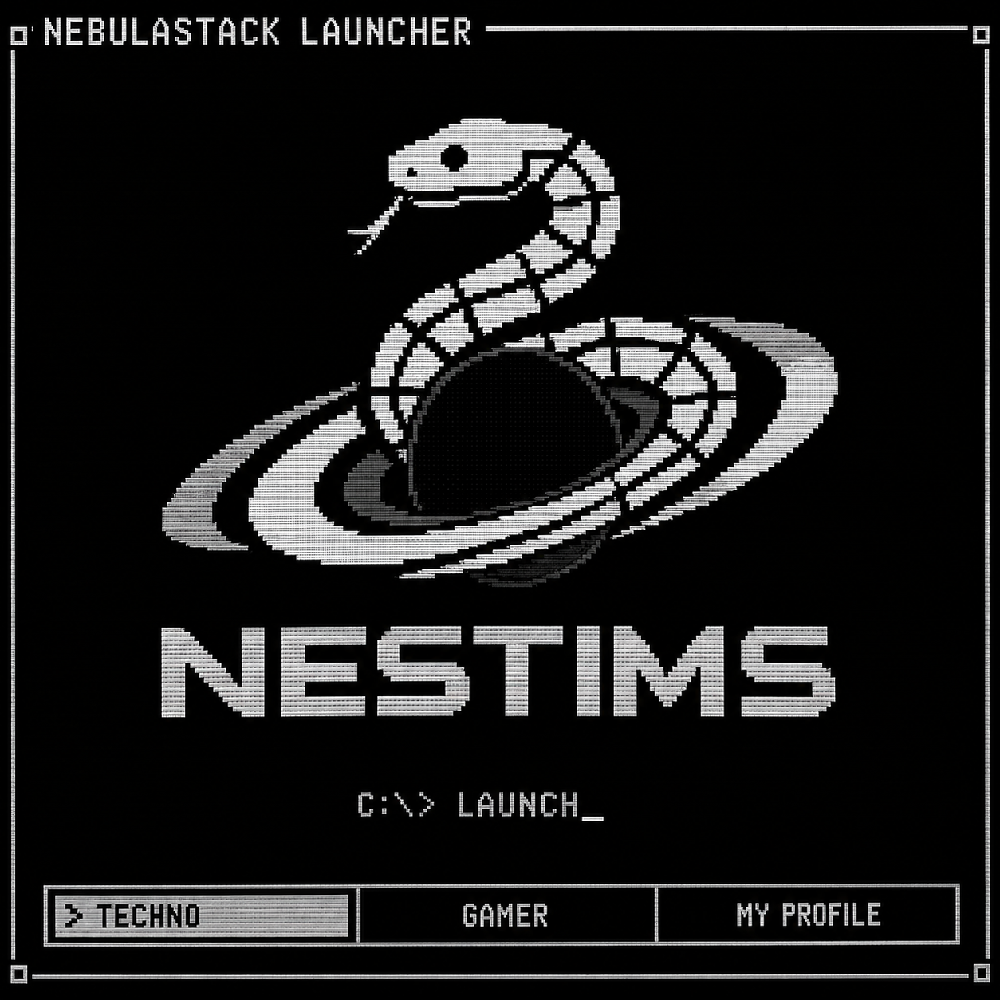
</p>

<p align="center">
  <strong>NS-019 · Product</strong>
</p>

<p align="center">
  A personal launcher for games, applications, and tools within the NESTIMS ecosystem.
</p>

## Overview

**NebulaStack Launcher** is a desktop launcher designed to bring games, applications, and personal projects together in one place.

The project provides a unified interface for launching executable files, organizing software into separate zones, and maintaining a personal collection of games and applications. It combines a custom terminal interface, animated startup sequence, user profiles, and a local database.

NebulaStack Launcher is part of the NESTIMS ecosystem, which brings together software development, technology, experiments, and interactive projects.

## Features

### 1. Gamer Zone

A dedicated section for games available within the launcher.

* Automatically scans the designated games directory.
* Displays detected games in a navigable list.
* Launches supported game files.
* Supports custom display names through metadata files.
* Allows users to add games to their personal profiles.

### 2. Techno Zone

A dedicated section for software, utilities, and technical projects.

* Automatically detects supported applications.
* Organizes programs separately from games.
* Launches applications directly from the interface.
* Supports custom display names and descriptions.

### 3. My Profile

A local user profile system for organizing a personal collection.

* User registration and login.
* Automatic login through a locally stored session.
* Account creation and last-login timestamps.
* Personal game collection.
* Ability to add and remove games from a profile.

### 4. Startup Animation

The launcher features a custom boot sequence inspired by classic computer startup screens.

The sequence includes:

* CRT-style power-on animation.
* Visual noise and glitch effects.
* A simulated BIOS screen.
* Animated NebulaStack ASCII branding.
* Loading indicators for launcher components.

### 5. Bilingual Interface

The Gamer Zone and Techno Zone support Russian and English interface text. Users can switch languages through launcher commands.

### 6. Automatic File Discovery

The launcher scans its designated directories and identifies supported file types.

Supported extensions:

* `.exe` – Windows executables
* `.bat` and `.cmd` – Windows command scripts
* `.lnk` – Windows shortcuts
* `.py` – Python scripts
* `.jar` – Java applications
* `.html` – HTML files opened in a web browser

## Technology Stack

| Technology            | Purpose                                |
| --------------------- | -------------------------------------- |
| Python                | Core application logic                 |
| SQLite                | Local user and profile database        |
| JSON                  | Session storage                        |
| Colorama              | Colored terminal interface             |
| `subprocess`          | Launching applications and scripts     |
| `webbrowser`          | Opening HTML files                     |
| `hashlib`             | Password hashing                       |
| ANSI escape sequences | Terminal animations and visual effects |

## Project Structure

The launcher automatically creates its main directories when started.

```text
NebulaStack Launcher/
├── NebulaStackLauncher.exe
├── games/
│   ├── gamer/
│   └── techno/
└── data/
    ├── nebula.db
    └── session.json
```

### `games/`

Contains the applications and games available in the launcher.

* `gamer/` – games.
* `techno/` – software, tools, and technical projects.

Files can also be placed inside individual subdirectories. The launcher searches each subdirectory for a supported launchable file.

### `data/`

Stores local application data.

* `nebula.db` – SQLite database containing user accounts and profile collections.
* `session.json` – locally stored login session.

**Note:** These files are generated automatically. Their presence depends on whether the relevant features have been used.

## How to Use

1. Download and run the launcher executable [(v1.0.0)](https://github.com/NebulaStack-prog/NebulaStack-Launcher/releases/tag/v1.0.0) [(v2.0.0)](https://github.com/NebulaStack-prog/NebulaStack-Launcher/releases/tag/v2.0.0).
2. Wait for the startup sequence to finish.
3. Select `GAMER ZONE`, `TECHNO ZONE`, or `MY PROFILE`.
4. Place supported applications in the corresponding directory.
5. Return to a zone and refresh its list if you add new files while the launcher is running.
6. Navigate using the arrow keys and press `ENTER` to launch the selected item.

### Available Commands

Inside Gamer Zone and Techno Zone:

| Command   | Action                               |
| --------- | ------------------------------------ |
| `/h`      | Display help                         |
| `/q`      | Return to the main menu              |
| `/add`    | Add the selected item to the profile |
| `/r`      | Refresh the file list                |
| `/set ru` | Switch to Russian                    |
| `/set en` | Switch to English                    |

Inside My Profile:

| Command   | Action                                    |
| --------- | ----------------------------------------- |
| `/d`      | Remove the selected item from the profile |
| `/logout` | Log out and clear the saved session       |
| `/q`      | Return to the main menu                   |

## Data Storage

NebulaStack Launcher uses a local SQLite database to store user accounts and profile collections. Session information is stored in a JSON file.

The application is designed around local storage and does not require a remote database for its core functionality.

**Security note:** This project is a personal software product, not a hardened authentication system. The source version includes a default administrator account, and its original password hashing uses unsalted SHA-256. These mechanisms should be improved before distributing the launcher for use with real or sensitive accounts. Do not reuse important passwords in this application.

## Project Information

| Property         | Value                 |
| ---------------- | --------------------- |
| Project          | NebulaStack Launcher  |
| Project ID       | NS-019                |
| Status           | Product               |
| Ecosystem        | NebulaStack / NESTIMS |
| Primary Language | Python                |
| Database         | SQLite                |
| Interface        | Terminal-based UI     |

## Future Development

Possible directions for future versions include:

* A graphical interface.
* Improved account security.
* Expanded application metadata and descriptions.
* Better profile management.
* Integration with additional NebulaStack and NESTIMS projects.
* An integrated AI assistant.
* More flexible application discovery and organization.

These are potential improvements rather than features currently guaranteed by the implementation.

## Disclaimer

NebulaStack Launcher is an independently developed project within the NESTIMS ecosystem. Compatibility may vary depending on the operating system, installed dependencies, and the applications being launched.

## Screenshots (v1.0.0)

### Startup Sequence

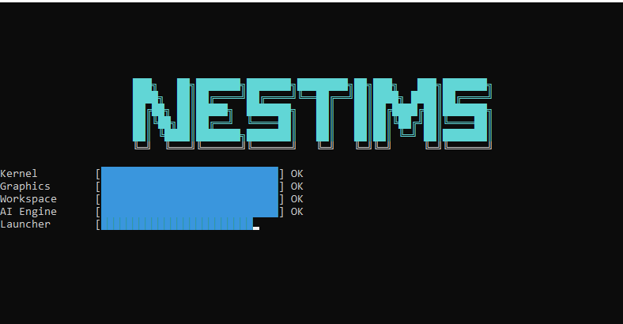

### Main Menu

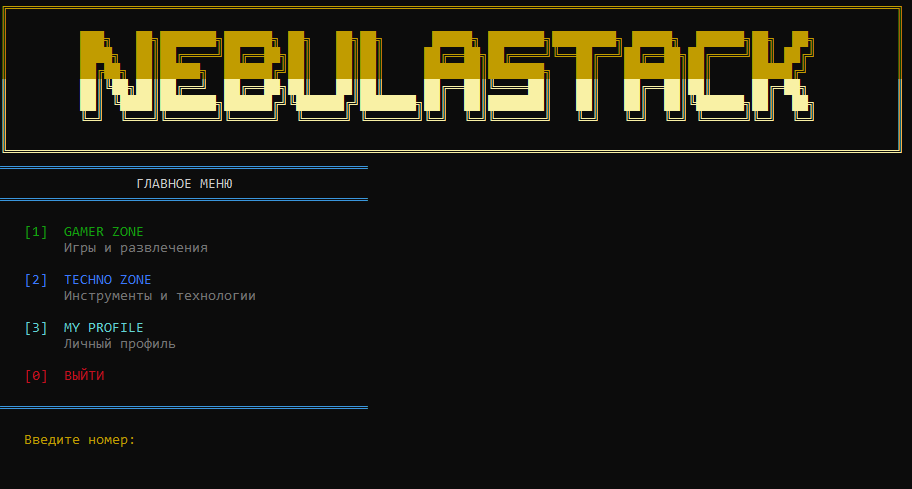

### Gamer Zone

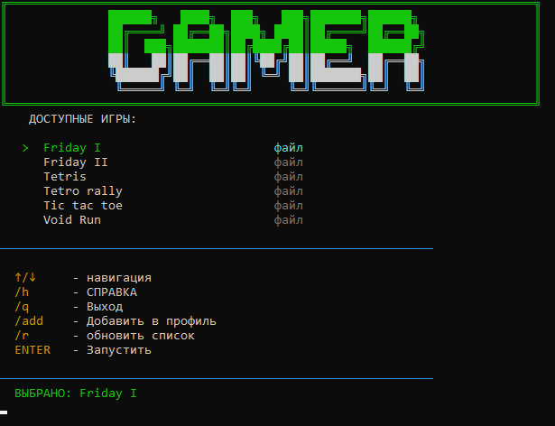

### Techno Zone

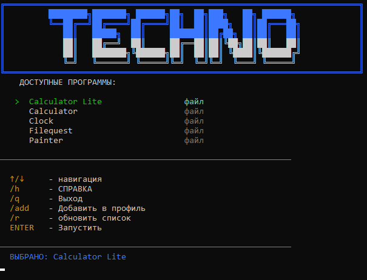

### My Profile

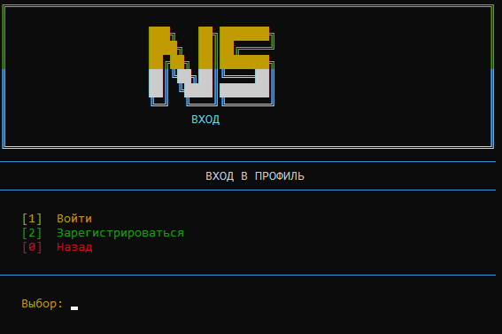
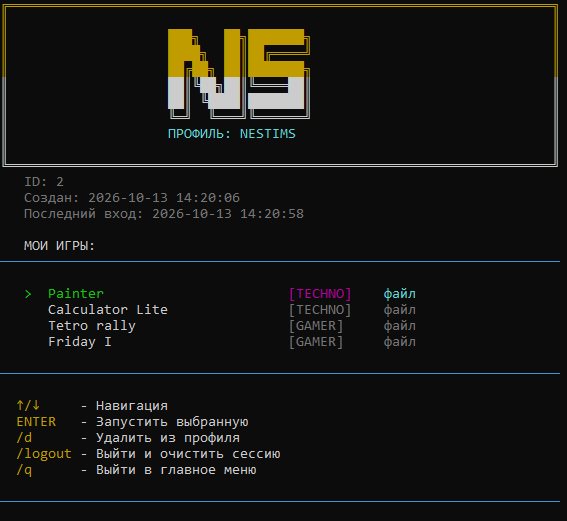

## Screenshots (v2.0.0)

### Startup Sequence


### Main Menu

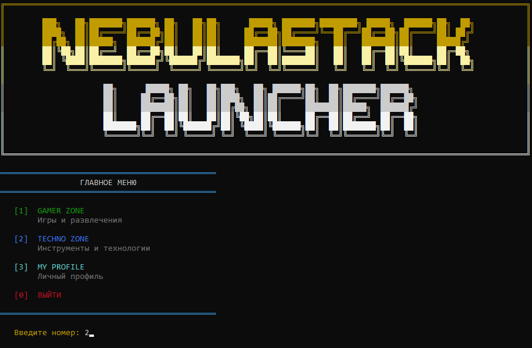

### Gamer Zone

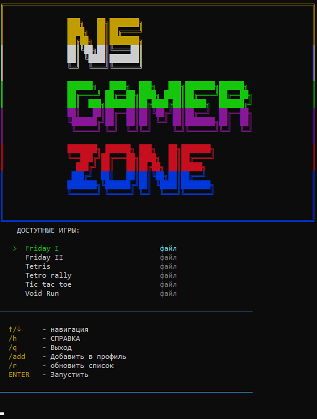

### Techno Zone

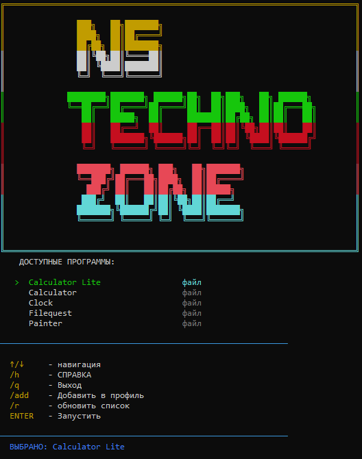

### My Profile

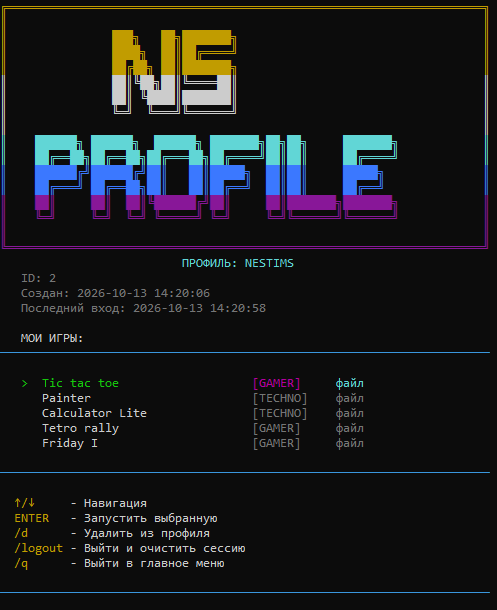

## Author

>*Technology, experimentation, and software development.*

© NESTIMS

